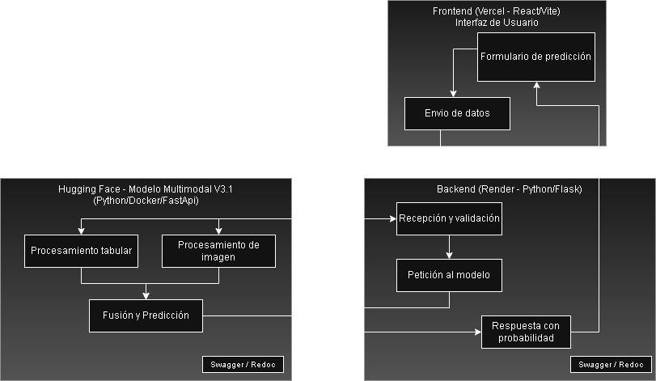
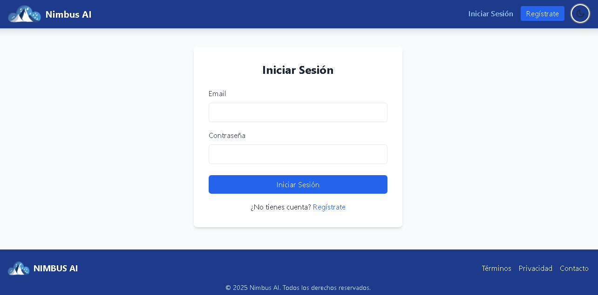

# Nimbus AI 🌩️


**Nimbus AI** es un sistema de alerta temprana de granizo para la región de Mendoza, Argentina, basado en un modelo de machine learning multimodal. Su objetivo es predecir la probabilidad de granizo combinando datos meteorológicos y análisis de imágenes satelitales para la prevención de daños agrícolas y materiales.

---

## 📜 Tabla de Contenidos

1.  [El Problema](#-el-problema)
2.  [La Solución](#-la-solución)
3.  [Demostraciones Visuales](#-demostraciones-visuales)
4.  [Aplicación Web](#-aplicación-web)
5.  [Modelo de IA y API](#-modelo-de-ia-y-api)
6.  [Dataset](#-dataset)
7.  [Documentación Detallada](#-documentación-detallada)
8.  [Stack Tecnológico](#️-stack-tecnológico)
9.  [Guía de Inicio Rápido](#-guía-de-inicio-rápido-getting-started)
10. [Contribuciones](#-contribuciones)
11. [Agradecimientos](#-agradecimientos)
12. [Licencia](#-licencia)

---

## 🎯 El Problema

El granizo representa una amenaza significativa en regiones agrícolas como Mendoza, causando anualmente pérdidas millonarias en cultivos, así como daños a propiedades y vehículos. Los sistemas de alerta tradicionales a menudo carecen de la especificidad y anticipación necesarias para una prevención eficaz.

## ✨ La Solución

Nimbus AI ofrece una solución proactiva y focalizada:

*   **Modelo Multimodal:** Fusiona datos numéricos (temperatura, humedad, viento) con datos visuales (imágenes satelitales GOES-16 para entrenar y GOES-19 en producción, ambos de NOAA) para una predicción más robusta y precisa.
*   **Salida Probabilística:** Entrega una probabilidad de granizo, permitiendo a los usuarios tomar decisiones informadas basadas en su propio umbral de riesgo.
*   **Plataforma Centralizada:** Provee una interfaz web con dashboards especializados para diferentes roles (Administrador, Defensa Civil, Meteorólogo, Científico de Datos y Usuario General).

---

## 🖼️ Demostraciones Visuales

*Arquitectura del sistema.*



*Login.*



---

## 🔗 Aplicación Web

*   **Acceso a la plataforma:** [https://nimbus-ai-mdz.vercel.app/](https://nimbus-ai-mdz.vercel.app/)

---

## 🤖 Modelo de IA y API

### Estado del Modelo (honesto)

Nimbus es un **prototipo de investigación**, no un sistema operativo de alerta. Estas son las métricas sobre el conjunto de prueba (94 filas, 10 con granizo, 10,6 % de positivos):

| Versión | Umbral | Recall | Precisión | Comentario |
| :------ | :----: | :----: | :-------: | :--------- |
| V3.0 | 0,50 | 0,70 | 0,21 | Doble de precisión que el azar (10,6 %), pero con solo 10 positivos la incertidumbre es enorme. |
| V3.1 | 0,50 | 1,00 | 0,14 | Alerta en el 75 % de los días sin granizo: casi no discrimina. |
| V3.1 | 0,56 (desplegado) | 0,00 | — | Con el umbral de la API no detecta ningún evento del test. |

### Limitaciones conocidas (en corrección para V4)

*   **Fuga de validación:** el conjunto de prueba se usó como validación del EarlyStopping (V3.0) y como objetivo del Keras Tuner (V3.1). No hubo un holdout sin tocar.
*   **Fuga por fecha:** cada fecha aparece en ~5 estaciones que comparten la misma imagen satelital; la división aleatoria por filas deja la misma tormenta en train y test.
*   **Etiquetas incompletas:** provienen de noticias y registros públicos. Un día sin reporte no implica un día sin granizo, y los reportes crecen con los años por la mayor cobertura online.
*   **Diferencias entre entrenamiento y producción:** variables como `año` o `SNWD` y la secuencia de 5 imágenes no se reproducen igual al predecir.

El plan de V4 incluye validación temporal por temporada, un test que no se toca, comparación contra modelos de referencia y variables convectivas (CAPE, cizalladura, isoterma de 0 °C, rayos).

### API Desplegada

El modelo está desplegado y accesible a través de los siguientes endpoints en Hugging Face:

*   **Documentación Interactiva (Swagger):** [https://nahuelito22-nimbus-ai.hf.space/api/docs](https://nahuelito22-nimbus-ai.hf.space/api/docs)
*   **Health Check:** [https://nahuelito22-nimbus-ai.hf.space/api/health](https://nahuelito22-nimbus-ai.hf.space/api/health)

### Ejemplos de Uso

La API recibe las 21 variables diarias que usa el modelo; la imagen GOES-19 la descarga ella misma. En la plataforma, el backend arma este payload desde Open-Meteo a partir de `lat`/`lon` (`GET /api/main-prediction?lat=..&lon=..`).

```bash
curl -X POST "https://nahuelito22-nimbus-ai.hf.space/api/predict"      -H "Content-Type: application/json"      -d '{
           "PRCP": 2.1, "SNWD": 0, "TAVG": 24.5, "TMAX": 32.0, "TMIN": 17.0,
           "latitude": -32.89, "longitude": -68.84,
           "om_weather_code": 63, "om_rain_sum": 2.1, "om_snowfall_sum": 0,
           "om_precipitation_hours": 3, "om_wind_gusts_10m_max": 45.0,
           "om_wind_direction_10m_dominant": 180, "om_shortwave_radiation_sum": 22.0,
           "om_et0_fao_evapotranspiration": 5.5, "om_dew_point_2m_mean": 12.0,
           "om_relative_humidity_2m_mean": 55, "om_pressure_msl_mean": 1010.0,
           "mes": 1, "dia_del_año": 15, "rango_temp_diario": 15.0
         }'
```

### Ejemplo de Respuesta de la API

```json
{
  "probabilidad_granizo": 0.43,
  "umbral_aplicado": 0.56,
  "alerta_sugerida": "No",
  "timestamp_prediccion_utc": "2026-01-15T18:00:00+00:00",
  "fuente_imagen_utilizada": "ABI-L2-CMIPF/2026/015/17/OR_ABI-L2-CMIPF-M6C13_G19_..."
}
```

---

## 💾 Dataset

La construcción del dataset fue un proceso iterativo y de enriquecimiento progresivo:

1.  **Línea Base (NOAA):** Se partió de un dataset con registros climáticos de Mendoza desde 1970 hasta 2024, provisto por la NOAA.
2.  **Enriquecimiento de Features (Open-Meteo):** Para mejorar la granularidad, se añadieron más variables climáticas utilizando la API de Open-Meteo, acotando el período de 2000 a 2024.
3.  **Etiquetado de Eventos (Web Scraping):** El desafío principal fue obtener etiquetas precisas de eventos de granizo. Se realizó web scraping sobre el portal `TuTiempo.net` y se complementó con una exhaustiva verificación manual de noticias y registros históricos entre 2000 y 2024. El resultado fue el archivo `dataset_final_enriquecido.csv`.
4.  **Incorporación de Imágenes Satelitales (GOES-16):** Para el modelo multimodal (v3.0), se recolectaron imágenes del satélite GOES-16 para cada fecha etiquetada como "evento" y "no evento" a partir de 2017 (año de despliegue del satélite).

Este dataset multimodal (101 fechas, 466 filas estación-día) se usó para entrenar V3.0 y V3.1 (V3.1 optimizado con Keras Tuner). Ver *Limitaciones conocidas*.

---

## 📚 Documentación Detallada

Para una exploración más profunda de la arquitectura, el análisis exploratorio de datos (EDA), el entrenamiento del modelo y las decisiones de diseño, puedes consultar la documentación completa en Deepwiki:

*   **Wiki del Proyecto:** [https://deepwiki.com/Nahuelito22/Nimbus-AI](https://deepwiki.com/Nahuelito22/Nimbus-AI)

---

## 🛠️ Stack Tecnológico

*   **Backend:** Python, Flask, SQLAlchemy, JWT (API del modelo: FastAPI)
*   **Frontend:** React.js, Vite, Tailwind CSS
*   **Data Science:** TensorFlow/Keras, Pandas, Scikit-learn, Xarray
*   **Base de Datos:** PostgreSQL
*   **Despliegue:** Vercel (Frontend), Hugging Face Spaces con Docker (Backend y API del modelo)

---

## 🏁 Guía de Inicio Rápido (Getting Started)

Sigue estos pasos para levantar el proyecto en un entorno local.

### Prerrequisitos

*   Python 3.9+ y `pip`
*   Node.js 18+ y `npm`
*   Git

### 1. Configuración del Backend

```bash
# Clona, crea entorno virtual e instala dependencias
git clone https://github.com/tu-usuario/Nimbus_AI.git
cd Nimbus_AI
python -m venv venv
source venv/bin/activate  # En Windows: venv\\Scripts\\activate
pip install -r requirements.txt

# Configura y corre el servidor
cp .env.example .env # Ajusta tus variables en .env
python run.py
```

### 2. Configuración del Frontend

```bash
# En otra terminal, navega al frontend, instala y corre
cd frontend
npm install
npm run dev
```

---

## 🤝 Contribuciones

Las contribuciones son bienvenidas. Si deseas mejorar el proyecto, por favor, abre un *issue* para discutir los cambios o envía un *pull request*.

---

## 🙏 Agradecimientos

*   A la **NOAA** por proveer los datos climáticos históricos.
*   A **Open-Meteo** por su increíble API de datos meteorológicos.
*   A la comunidad de código abierto por las herramientas que hicieron posible este proyecto.

---

## 📄 Licencia

Este proyecto está bajo la Licencia MIT.

---

## 👤 Autor y Contacto

*   **Nahuel Ghilardi:** Data Science, Backend & Frontend Development

Para reportar un problema o hacer una pregunta, por favor, abre un [issue en GitHub](https://github.com/tu-usuario/Nimbus_AI/issues).
